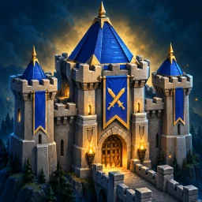
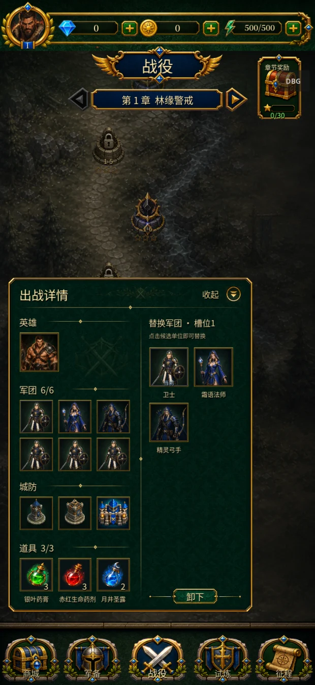
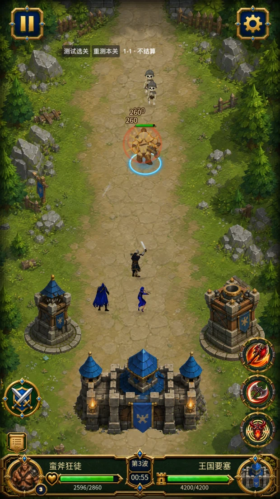
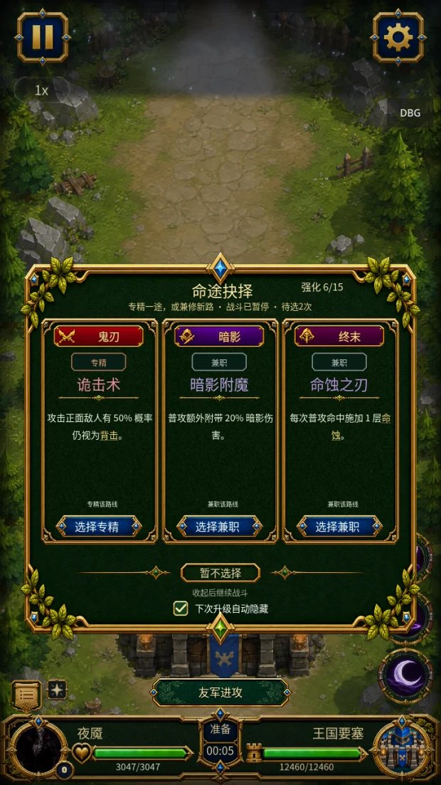

  

<h1 align="center">War Tower</h1>

<strong>A mobile strategy game with tower defense and branching hero builds.</strong> In development · Solo indie project

## How a battle plays

- **Deploy your defense.** Choose a hero, troops, and towers before the first enemy wave.
- **Fight on the front line.** Move your hero and time their abilities while troops and towers help keep enemies away from the fortress.
- **Build your hero as you go.** Pick one of three perks between waves. Your choices can take the same hero down a different build path on the next run.

## Development screenshots

| Prepare your lineup | Defend the fortress | Choose a perk |
| :---: | :---: | :---: |
|  |  |  |

## In development

I'm building War Tower as a solo developer. The game has a Godot client and a TypeScript backend. Seeded battle replays help me reproduce combat bugs and check whether a fix changes how a battle plays out.

This repository is the public project showcase. The game is in pre-launch development and the source code is private.
